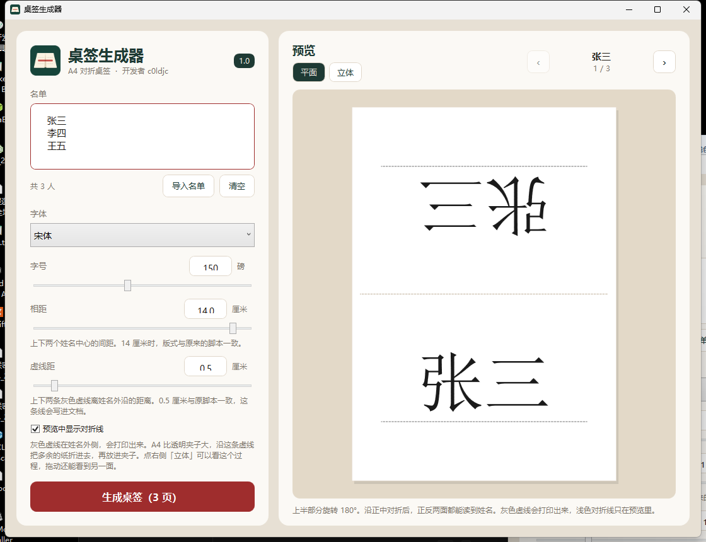

# 桌签生成器

把一份名单做成可对折的 A4 桌签。

以前要在 Word 里给每个人单独改桌签。用这个生成器，一份名单就能一次生成所有人的。

桌签夹大小不一样。调整虚线的位置，就能确定对折的地方，适配不同大小的夹子。




下载：[桌签生成器.exe](https://github.com/c01djc/desk-sign/releases/download/v1.0/桌签生成器.exe)（64 位 Windows，一个文件）

版本 1.0 · [MIT](LICENSE)

## 编译

需要 .NET 10 SDK（含 Windows 桌面）。

```bash
dotnet test DeskSign.slnx
dotnet publish src/DeskSign/DeskSign.csproj -c Release -r win-x64 --self-contained true -p:PublishSingleFile=true -p:IncludeNativeLibrariesForSelfExtract=true -p:EnableCompressionInSingleFile=true -p:DebugType=none -p:DebugSymbols=false -o 单文件
```
